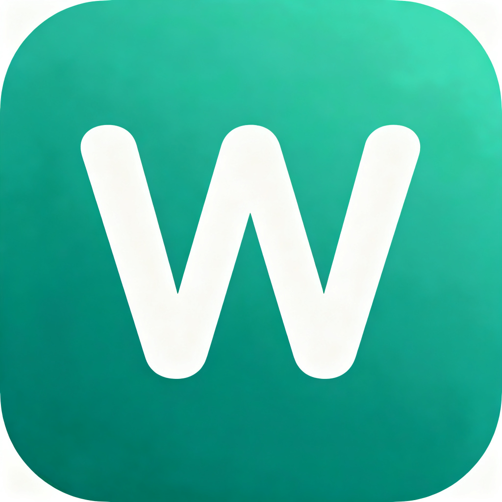
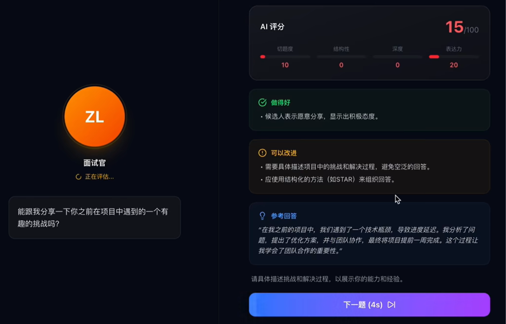
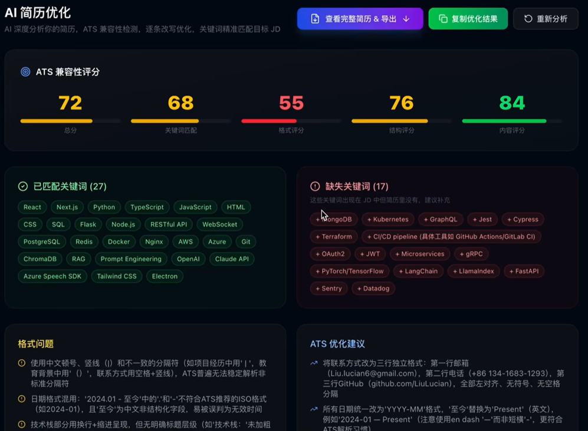
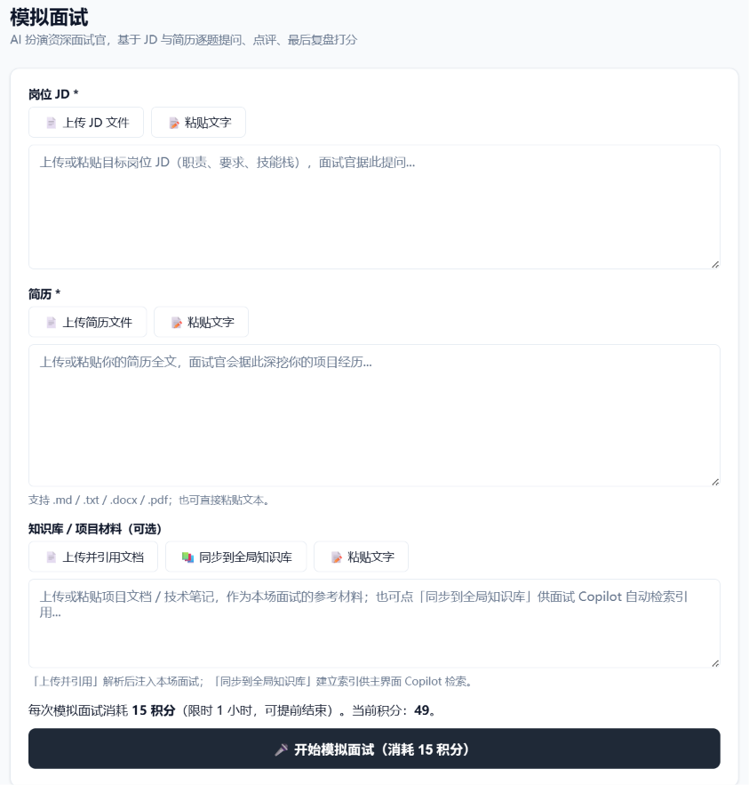

# 面翼 MeetsWin

**AI 面试陪练 · 把每一次面试，都练成一场胜券在握的谈话**

模拟面试 ｜ 简历优化 ｜ 实战演练 ｜ 面试记录

[⬇ 下载最新版](https://github.com/TomLjm/MeetsWin/releases/latest) ・ [🌐 访问官网](https://meetswin.com.cn) ・ [📢 反馈建议](https://github.com/TomLjm/MeetsWin/issues)

---

[🎬 一分钟看懂](#-一分钟看懂面翼) ・ [✨ 核心功能](#-核心功能) ・ [🚀 快速开始](#-快速开始) ・ [👋 关注我们](#-关注我们) ・ [🔒 隐私与合规](#-隐私与合规) ・ [📮 联系与反馈](#-联系与反馈)

## 🎬 一分钟看懂面翼

点击播放，看看面翼是怎么帮你准备面试的：

<video src="assets/demo-tutorial.mp4" controls="controls" width="100%"></video>

> 完整使用教程请访问 [官网教程页](https://meetswin.com.cn)。

### 🎧 实战演练实录：真实面试场景

在腾讯会议等视频面试中，面翼实时转录对方提问并给出结构化应答参考：

<video src="assets/demo-copilot-interview.mp4" controls="controls" width="100%"></video>

---

## ✨ 核心功能

### 🗣️ 模拟面试：AI 面试官，逐题追问，实时评分

上传简历和岗位 JD，AI 扮演资深面试官逐题提问。每道题实时给出 **切题度 / 结构性 / 深度 / 表达力** 四维评分，并附「做得好」「可以改进」「参考回答」三段反馈，面试结束输出完整复盘。

### 📄 简历优化：AI 深度分析 + ATS 兼容性检测

AI 逐行分析你的简历，对照目标 JD 做 **ATS 兼容性评分**（关键词匹配 / 格式 / 结构 / 内容），标出已匹配与缺失关键词，并给出逐条改写建议，让简历真正过得了机器、也过得了 HR 的眼。

### 🛠️ 面试前准备：JD + 简历 + 知识库，一键开练

上传岗位 JD、简历和项目文档，AI 基于你的真实材料提问，面试官会深挖你的项目经历——练的就是你面试时要讲的那套东西。

---

## 🚀 快速开始

1. 下载客户端（Windows 10 / 11 x64）：[GitHub Release](https://github.com/TomLjm/MeetsWin/releases/latest) 或 [官网下载](https://meetswin.com.cn)
2. 注册账号：**注册即送 3 积分 + 每台设备 30 分钟免费试用**
3. 上传简历与 JD，选择语言与风格，开始你的第一场模拟面试

支持中英文双语，秋招 / 春招 / 实习 / 社招均适用。

---

## 👋 关注我们

产品动态、使用技巧、求职干货都会同步更新，欢迎关注：

| 平台 | 主页 |
| --- | --- |
| 📕 小红书 | [面翼MeetsWin](https://xhslink.cn/o/32H2FDRBdqZ) |
| 📺 B 站 | [面翼MeetsWin](https://b23.tv/pAoZhvG) |
| 💬 知乎 | [面翼MeetsWin](https://www.zhihu.com/people/3127f374c2fcc816799c4f76bd7ce78f) |
| 🎵 抖音 | 搜索关注 **面翼MeetsWin** |

---

## 🔒 隐私与合规

- 面试音视频本地处理、不上传不存储，仅在用户主动使用时调用模型；
- AI 生成内容均标注「AI 生成」。

---

## 📮 联系与反馈

- 官网：<https://meetswin.com.cn>
- 客服 QQ：**3359887324**（备注「面翼用户」）
- 客服微信：**Tom331997**（备注「面翼用户」）

使用中遇到任何问题，欢迎 [提交 Issue](https://github.com/TomLjm/MeetsWin/issues) 或联系客服反馈。
